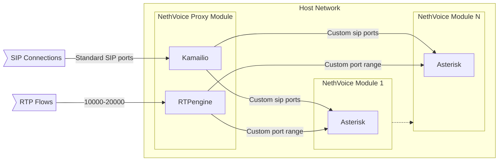

# ns8-nethvoice-proxy

NS8 NethVoice proxy module, a SIP and RTP proxy allows multiple instances of
NethVoice to be hosted on the same Node.
The proxy uses Kamailio and rtpengine as core components.

This module is developed by [evoseed](https://evoseed.io/) and maintained by Nethesis.
Most of the development is tracked privately inside [evoseed portal](https://nethesis.evoseed.it/).

## Module overview



## Install

Instantiate the module with:

    add-module ghcr.io/nethesis/nethvoice-proxy:latest 1

The output of the command will return the instance name.
Output example:

    {"module_id": "nethvoice-proxy1", "image_name": "nethvoice-proxy", "image_url": "ghcr.io/nethesis/nethvoice-proxy:latest"}

## Configure

Let's assume that the nethvoice-proxy instance is named `nethvoice-proxy1`.

Launch `configure-module`, by setting the following parameters:

- `fqdn`: name of Let's Encrypt certificate to use for Secure SIP connections, the phones must be
   configured to use this domain name as server SIP.
- `addresses`: configure the IP where the proxy will receive SIP and RTP connections/streams.
  - `address`: IPv4 address that is expected to receive VoIP traffic, **mandatory**.
  - `public_address`: public IPV4 address that is expected to receive
    VoIP traffic, in case of NAT.

Example:

    api-cli run module/nethvoice-proxy1/configure-module --data '{"fqdn": "example.com", "addresses": { "address": "192.168.1.1", "public_address": "1.2.3.4" }}'

## NAT scenario: local networks support

In on-premise installations where NethServer 8 is behind NAT
(`public_address` differs from `address`), Kamailio normally advertises
the public IP in SDP for all clients. Local clients (phones on the same
LAN) must then reach NethVoice through the public IP, which requires
hairpin NAT firewall rules — complex to configure and often unfeasible.

By providing the optional `local_networks` parameter the proxy avoids the
need for hairpin NAT by automatically:

1. Adding Kamailio listeners on ports **6060** (SIP/TCP/UDP) and **6061**
   (SIPS/TLS) bound to the private IP.
2. Creating firewall port-forwarding rules that redirect traffic arriving
   on 5060/5061 **from local network sources** to 6060/6061.
3. Configuring Kamailio to select `PRIVATE_IP:6060` as the outbound socket
   for destinations inside local networks, so the **private IP is
   advertised in SDP** for local clients — eliminating hairpin NAT.

Remote clients are unaffected and continue to use ports 5060/5061 with
the public IP in SDP.

The network directly attached to `address` is detected automatically from
the routing table. Additional subnets can be declared explicitly via
`local_networks`.

Example:

    api-cli run module/nethvoice-proxy1/configure-module --data \
      '{"fqdn": "proxy.example.com",
        "addresses": {"address": "192.168.1.1", "public_address": "1.2.3.4"},
        "local_networks": ["192.168.1.0/24", "10.0.0.0/8"]}'

The `local_networks` field accepts an array of CIDR-notation IPv4 subnets.
Port-forwarding rules are applied and removed automatically when the
configuration is updated or the module is destroyed.

## Debug

To enable Kamailio debug at runtime, launch

    kamcmd pv.shvSet debug int 1

TLS tracing is enabled when NethServer 8 support session is started, to enable it manually, launch

    kamcmd siptrace.status on 

## Alerts

The module publishes the `ServiceDown` alert for its services: kamailio,
postgres, redis and rtpengine. The `reason` label tells why it fires:

- `stopped`: the service failed, or is enabled and not running, for more than
  10 minutes
- `crash_loop`: systemd restarted it at least 3 times in a short time

The module also publishes `NethVoiceTrunkUnreachable` (critical) for the
trunks it relays for each NethVoice instance. It fires when the last answer
of the provider has been a failure for more than 10 minutes:

- `registration_rejected`: the provider answers with an error (for example
  403); the `$value` is the last SIP code
- `registration_timeout`: the provider does not answer, or cannot be reached
- `qualify_timeout`: the provider of an IP trunk (no registration) does not
  answer the OPTIONS checks of Asterisk. Asterisk counts the 408 sent by the
  proxy as an answer, so only the proxy can see a silent provider

Labels: `nethvoice` is the NethVoice instance, `trunk` is the To URI of the
REGISTER (`<user>@<domain>`) or of the OPTIONS (`<host>:<port>`). NethVoice publishes the same alert for the
trunks that do not use the proxy.

The alert summary and description also show the trunk name, for example
`Retel_GNR (203.0.113.5:5060)`. The name comes from the
`nethvoice_trunk_proxy_info` series of the NethVoice instance; when it is
missing (older NethVoice, NethVoice metrics not exported) only the `trunk`
label is shown.

Kamailio keeps the last answer in the `nvtrunkreg` htable for 25 hours, and
the last OPTIONS answer in `nvtrunkopt` for 1 hour. Read them with:

    curl -s -d '{"jsonrpc":"2.0","method":"htable.dump","params":["nvtrunkreg"],"id":1}' http://127.0.0.1:5060/RPC

Limits:

- Only the OPTIONS sent to a contact without user part (`sip:<host>:<port>`)
  are tracked, so phones are left out; an IP trunk whose contact has a user
  part is not checked. Devices registered through the proxy (kept in the
  `nvdevices` htable for 25 hours) are left out too, even when their contact
  has no user part. After a Kamailio restart a device is known again at its
  next registration, which also drops the OPTIONS answers stored for its
  address in the meantime; a de-registration forgets the device.
- When a trunk is disabled or deleted in NethVoice, its last answer stays
  until it expires (25 hours for registrations, 1 hour for OPTIONS), so a
  failing trunk keeps the alert firing for that time.
- The trunks of a removed NethVoice instance are not exported.
- Only UDP trunk registrations and OPTIONS are checked. Over TCP and TLS
  Asterisk sends from a random port, so the proxy cannot tell which NethVoice
  instance the trunk belongs to.
- When the provider stops for good after a fatal answer (for example 404), the
  last answer expires after 25 hours and the alert clears while the trunk is
  still broken.
- The NethVoice instance of a trunk is read from the dispatcher table of
  postgres at every export. While postgres is down or slow, the trunk metrics
  are missing (`nethvoice_proxy_exporter_collector_up{collector="kamailio"}`
  is 0) and a pending alert waits its 10 minutes again.
- A trunk REGISTER whose To URI has no user part gets the `<null>@<domain>`
  label.

The metrics are exported every 5 minutes; check them with
`runagent -m nethvoice-proxy1 export-metrics`. The alerts require core 3.24.0
or later, and the metrics app 1.7.0-dev.1 or later.

Known limit: moving or cloning the module stops kamailio and postgres on
purpose, while they stay enabled. If the transfer takes more than 10 minutes,
`ServiceDown` with `reason=stopped` fires for them. The alert clears by itself
when the services start again or the old instance is removed.

## Uninstall

To uninstall the instance:

    remove-module --no-preserve nethvoice-proxy1

## Testing

This module uses the NS8 standard testing infrastructure. For instructions on how to run the test suite locally, refer to the [Running tests locally](https://github.com/NethServer/ns8-github-actions/blob/v1/README.md#running-tests-locally).

## Components

### Kamailio

Kamailio® (successor of former OpenSER and SER) is an Open Source SIP Server
released under GPLv2+, able to handle thousands of call setups per second.
Website: [kamailio](https://www.kamailio.org/w/)

### Postgres

PostgreSQL is a powerful, open source object-relational database system with over
35 years of active development that has earned it a strong reputation for
reliability, feature robustness, and performance.
Website: [postgresql](https://www.postgresql.org/)

### Redis

The open source, in-memory data store used by millions of developers as a
database, cache, streaming engine, and message broker.
Website: [redis](https://redis.io/)

### RTPengine

The Sipwise NGCP rtpengine is a proxy for RTP traffic and other UDP based media
traffic. It's meant to be used with the Kamailio SIP proxy and forms a drop-in
replacement for any of the other available RTP and media proxies.
Website: [RTPengine](https://github.com/sipwise/rtpengine)

## How to run locally

1. Compile the .env

   ```bash
   cp .env.template .env
   ```

   Edit the .env file and set the correct values

1. Build the docker image and run it

   ```bash
   cd modules/postgres
   make build
   make run && make log

   cd modules/redis
   make build
   make run && make log

   cd modules/rtpengine
   make build
   make run && make log

   cd modules/kamailio
   make build
   make run && make log
   ```

## How to run remotely (DEV or PROD Virtual Machine)

1. Copy in the remote server the `Makefile`
1. Run the `init` stage to creation of `ENV` file and needed folder
   (`only first time`)

   ```bash
   make init
   ```

1. Run all the pods

   ```bash
   make run-all
   ```
